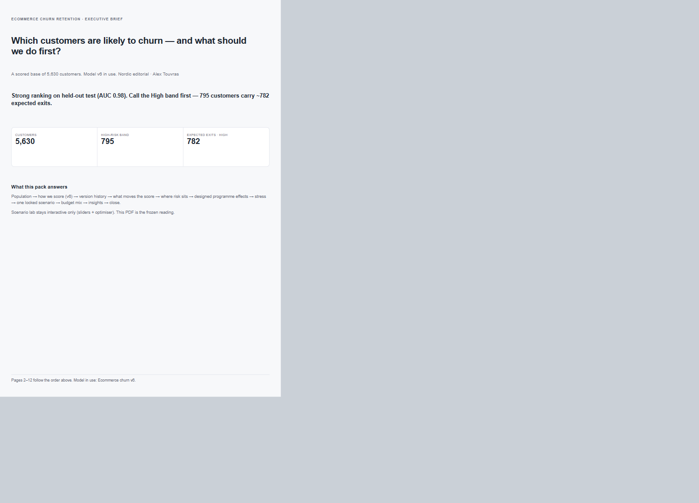
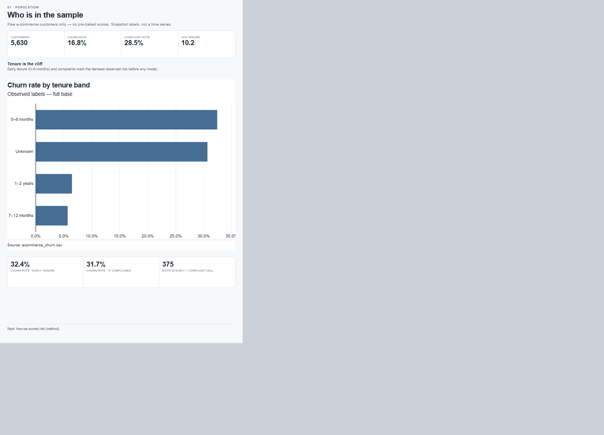
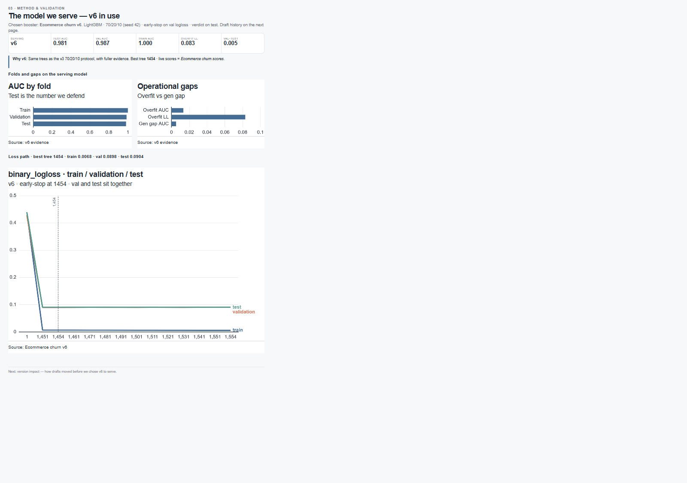

# 01 — Ecommerce Churn Retention

Snapshot churn propensity → risk bands → designed programme effects → frozen retention budget — committed path without the live what-if lab.

Frozen / journal pages only (OpenBI Studio Interactive labs are not in this repo).

## Preview

## Pages

| Id | Label | Role |
|----|-------|------|
| `cover-exec` | **Cover** | Question + one-line verdict |
| `population` | **Population** | Base descriptive metrics |
| `model-method` | **Model method** | Serving model protocol |
| `model-versions` | **Versions** | Holdout AUC ledger |
| `model-why` | **Drivers** | SHAP / interpretability |
| `risk-map` | **Risk map** | High / Med / Low bands |
| `science-effects` | **Effects** | Designed save rates |
| `science-stress` | **Stress** | Demanding OR experiments |
| `scenario-frozen` | **Scenario** | Locked programme mix |
| `budget-frozen` | **Budget** | Designed-cap OR plan |
| `insights` | **Insights** | Numbered findings |
| `close` | **Close** | Recommendations + limits |

## What's in the folder

| Piece | Path |
|-------|------|
| Screenshots | `screenshots/` |
| This page list | `README.md` |

Source Studio pack stays private in the OpenBI workspace. Re-export with `python scripts/export_orbit_openbi.py` from that workspace.
