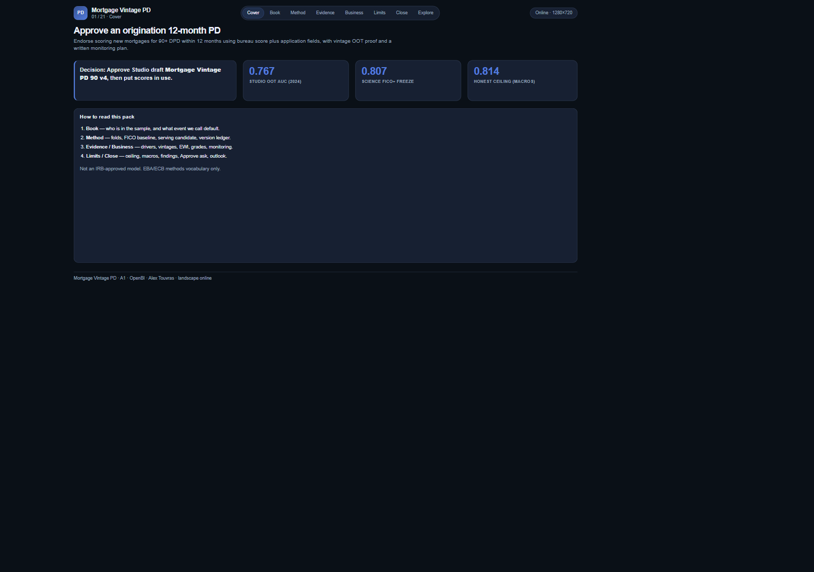
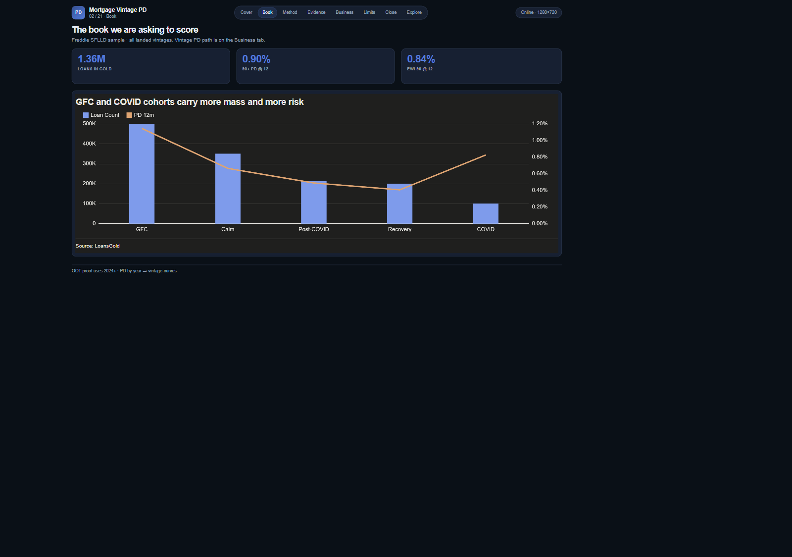
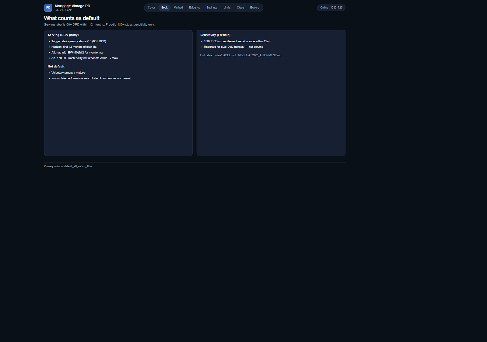

# 02 — Mortgage Vintage PD

Freddie through-the-door 12-month PD with FICO+ serving claim, vintage curves, EWI, and a Watch frozen ops path.

Frozen / journal pages only (OpenBI Studio Interactive labs are not in this repo).

## Preview

## Pages

| Id | Label | Role |
|----|-------|------|
| `cover-exec` | **Cover** | Vintage / OOT verdict |
| `population` | **Population** | Book + vintage mix |
| `label-definition` | **Label** | 90 DPD vs Freddie DoD |
| `model-method` | **Method** | Dev vs calibration |
| `fico-baseline` | **FICO baseline** | External score bar |
| `fico-plus` | **FICO+** | Lift beyond FICO |
| `model-versions` | **Versions** | OOS / OOT ledger |
| `model-why` | **Drivers** | Feature contributions |
| `vintage-curves` | **Vintages** | Realised 12m PD curves |
| `early-warning` | **EWI** | Early DQ lead–lag |
| `risk-grades` | **Grades** | LRA-calibrated grades |
| `monitoring` | **Monitoring** | PSI + vintage drift |
| `watch-pulse` | **Watch pulse** | Situation awareness |
| `monitor-frozen` | **Watch frozen** | Findings → options → actions |
| `insights` | **Insights** | Numbered findings |
| `close` | **Close** | Recommendations |

## What's in the folder

| Piece | Path |
|-------|------|
| Screenshots | `screenshots/` |
| This page list | `README.md` |

Source Studio pack stays private in the OpenBI workspace. Re-export with `python scripts/export_orbit_openbi.py` from that workspace.
