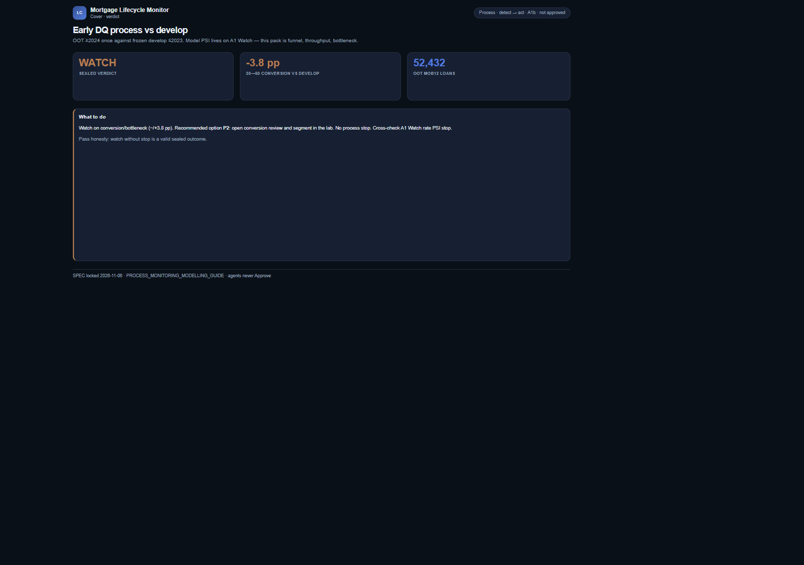
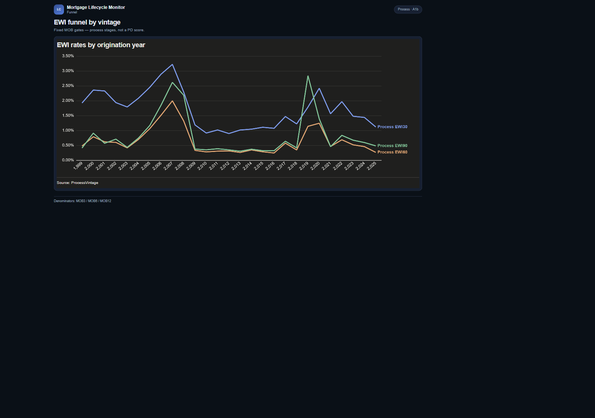
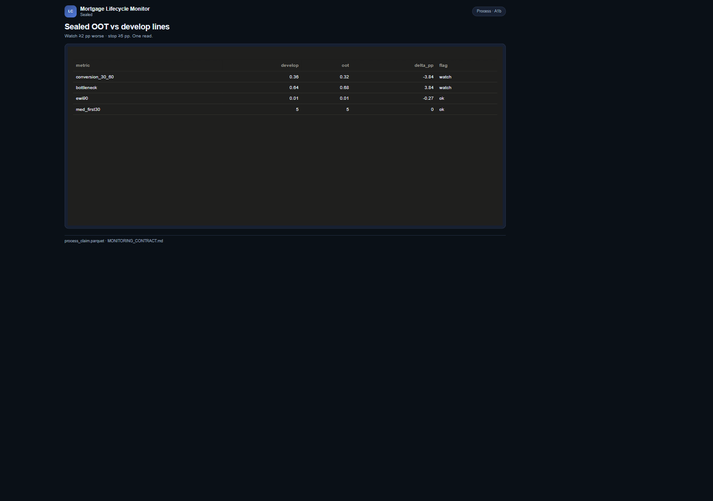

# 03 — Mortgage Lifecycle Monitor

Early-delinquency funnel / throughput vs a frozen develop baseline — process Watch, not a new PD score.

Frozen / journal pages only (OpenBI Studio Interactive labs are not in this repo).

## Preview

## Pages

| Id | Label | Role |
|----|-------|------|
| `cover` | **Cover** | OOT process verdict |
| `funnel` | **Funnel** | EWI 30/60/90 by vintage |
| `sealed` | **Sealed** | OOT vs frozen lines |
| `monitor-frozen` | **Frozen ops** | Findings → options → actions |
| `close` | **Close** | Limits + next pointers |

## What's in the folder

| Piece | Path |
|-------|------|
| Screenshots | `screenshots/` |
| This page list | `README.md` |

Source Studio pack stays private in the OpenBI workspace. Re-export with `python scripts/export_orbit_openbi.py` from that workspace.
