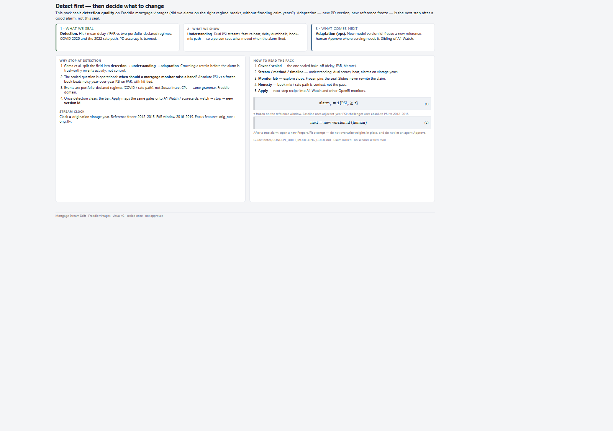
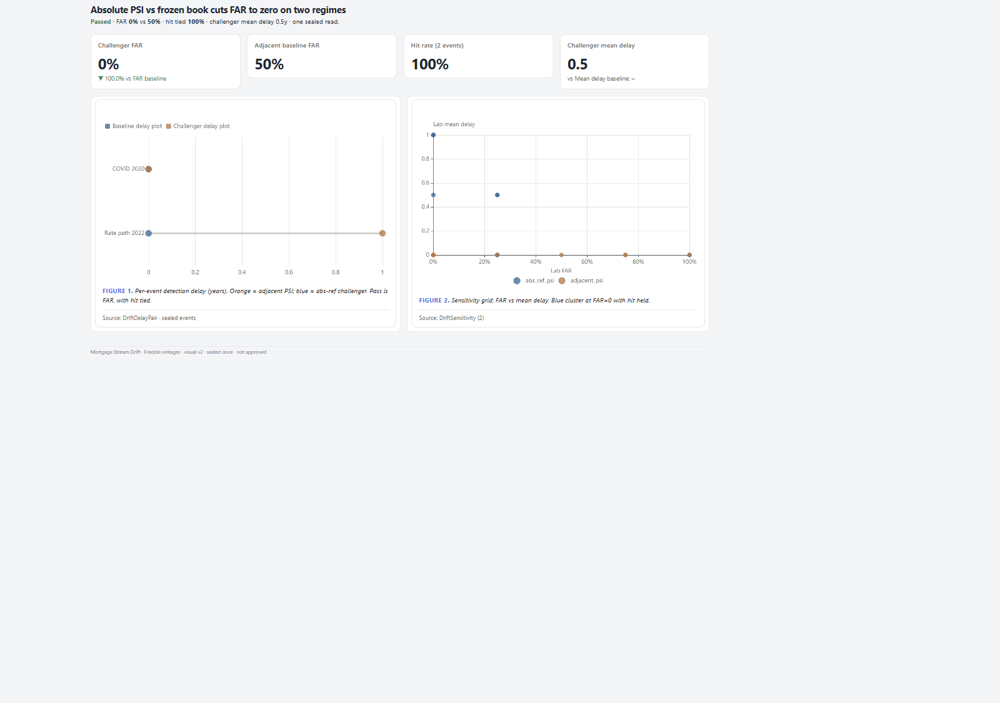
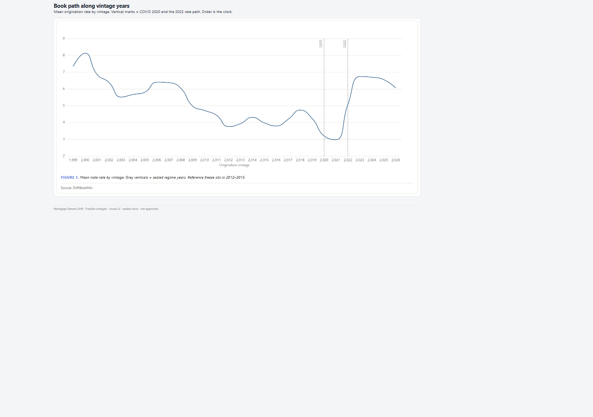

# 04 — Mortgage Stream Drift

Alarm when Freddie origination mix leaves a frozen reference — Insects drift grammar applied to credit.

Frozen / journal pages only (OpenBI Studio Interactive labs are not in this repo).

## Preview

## Pages

| Id | Label | Role |
|----|-------|------|
| `introduction` | **Introduction** | Detect → understand → adapt |
| `cover` | **Cover** | Sealed KPIs + delay |
| `stream` | **Stream** | Book rate + event marks |
| `method` | **Method** | PSI heat + freeze card |
| `timeline` | **Timeline** | Dual scores + alarms |
| `sealed` | **Sealed** | Delay / FAR compare |
| `monitor-frozen` | **Frozen lab** | Sealed stop defaults |
| `honesty` | **Honesty** | Book mix (not the pass) |
| `apply` | **Apply** | Watch → stop → new version |
| `close` | **Close** | Findings + limits |

## What's in the folder

| Piece | Path |
|-------|------|
| Screenshots | `screenshots/` |
| This page list | `README.md` |

Source Studio pack stays private in the OpenBI workspace. Re-export with `python scripts/export_orbit_openbi.py` from that workspace.
