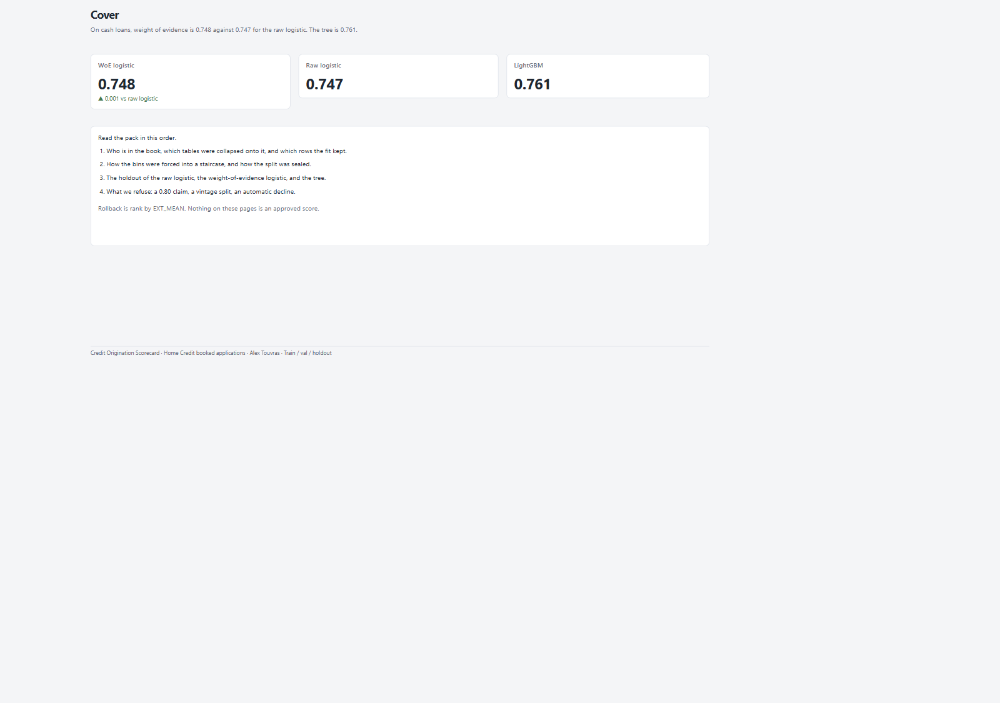
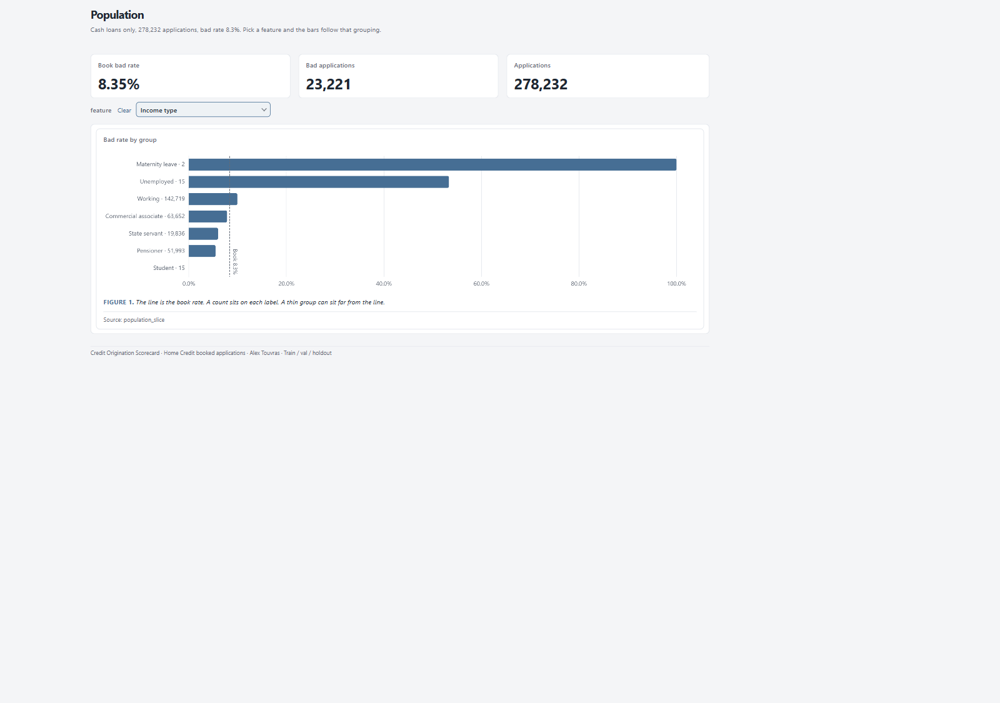
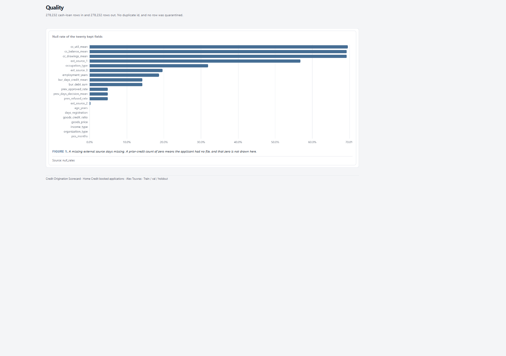

# 05 — Credit Origination Scorecard

Home Credit booked cash loans: WoE points card vs EXT_MEAN, with holdout grades and PSI honesty.

Frozen / journal pages only (OpenBI Studio Interactive labs are not in this repo).

## Preview

## Pages

| Id | Label | Role |
|----|-------|------|
| `cover` | **Cover** | Holdout Gini vs EXT_MEAN |
| `population` | **Population** | Cash-loan booked book |
| `quality` | **Quality** | Fit keep / quarantine |
| `outliers` | **Outliers** | Sentinel + fences |
| `sources` | **Sources** | Seven tables → fields |
| `characteristics` | **Characteristics** | IV + WoE bars |
| `scorecard` | **Scorecard** | Per-app points story |
| `model-method` | **Method** | Freeze + leakage denylist |
| `model-versions` | **Versions** | ROC / AUC ledger |
| `interpret` | **TreeSHAP** | Tree drivers (ceiling) |
| `calibration` | **Calibration** | Reliability + Brier |
| `grades` | **Grades** | Butterfly grade queue |
| `stability` | **Stability** | Train vs holdout PSI |
| `close` | **Close** | Findings + refusals |

## What's in the folder

| Piece | Path |
|-------|------|
| Screenshots | `screenshots/` |
| This page list | `README.md` |

Source Studio pack stays private in the OpenBI workspace. Re-export with `python scripts/export_orbit_openbi.py` from that workspace.
