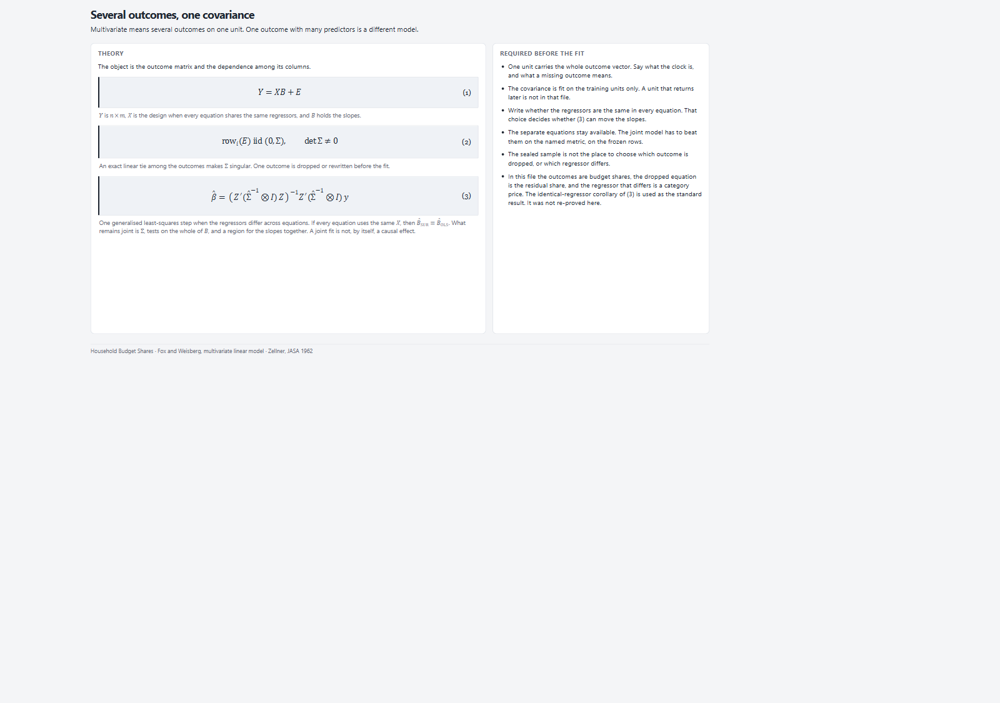
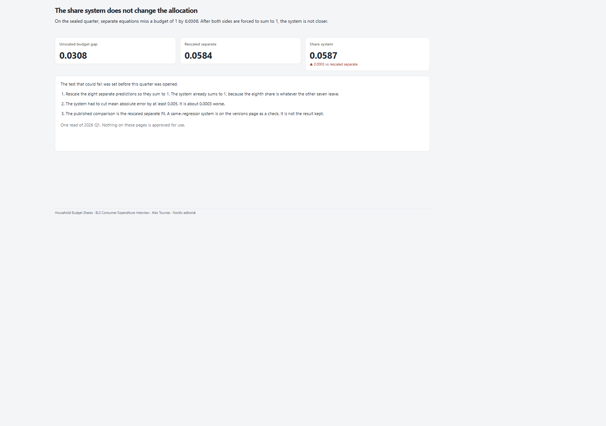
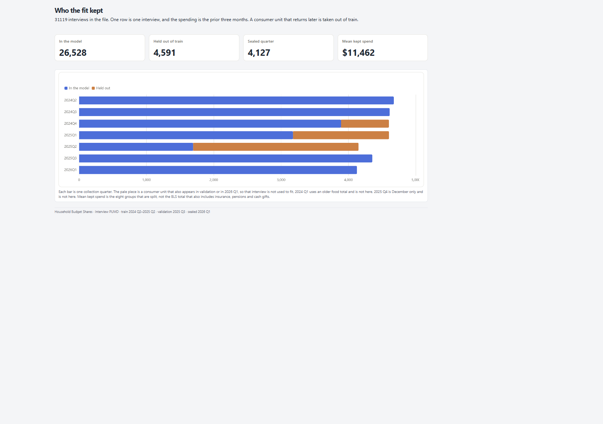

# 06 — Household Budget Shares

Multivariate share system vs rescaled separate equations — sealed category-MAE bar not met; gap still shown.

Frozen / journal pages only (OpenBI Studio Interactive labs are not in this repo).

## Preview

## Pages

| Id | Label | Role |
|----|-------|------|
| `introduction` | **Introduction** | Budget identity + gates |
| `cover` | **Cover** | Pass / miss on allocation |
| `population` | **Population** | Interviews + spend level |
| `label` | **Label** | Shares + omitted equation |
| `engel` | **Engel** | Shares vs budget size |
| `method` | **Method** | Freeze + category CPI |
| `dependence` | **Dependence** | Residual correlation |
| `prices` | **Prices** | Own-price slopes |
| `joint` | **Joint** | Joint slope region |
| `equations` | **Equations** | Slope story strip |
| `versions` | **Versions** | Gap + MAE seal |
| `why` | **Why** | Categories that move |
| `gap` | **Gap** | Unscaled miss shape |
| `close` | **Close** | Findings + limits |

## What's in the folder

| Piece | Path |
|-------|------|
| Screenshots | `screenshots/` |
| This page list | `README.md` |

Source Studio pack stays private in the OpenBI workspace. Re-export with `python scripts/export_orbit_openbi.py` from that workspace.
