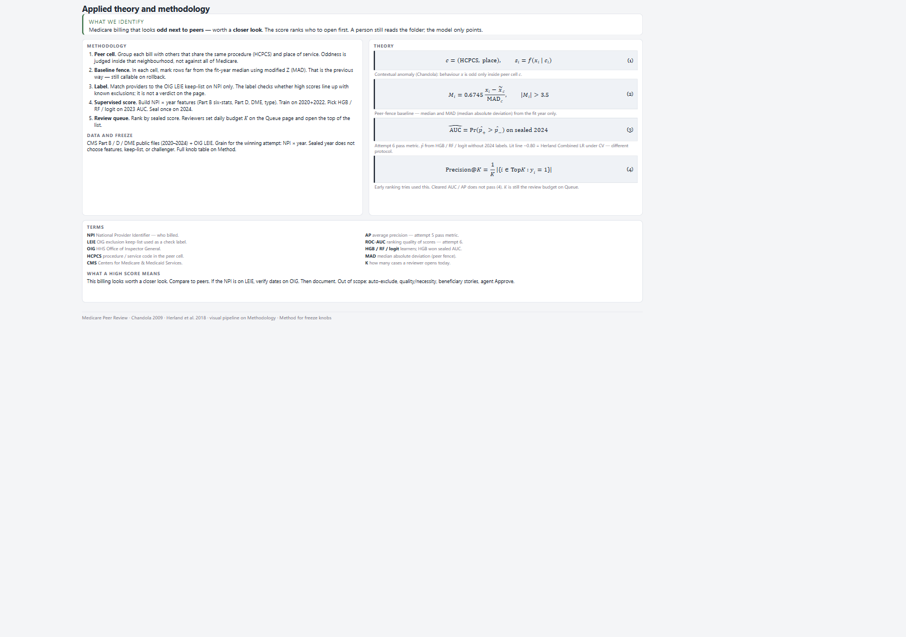
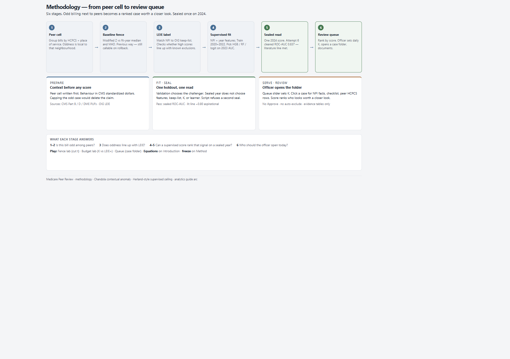
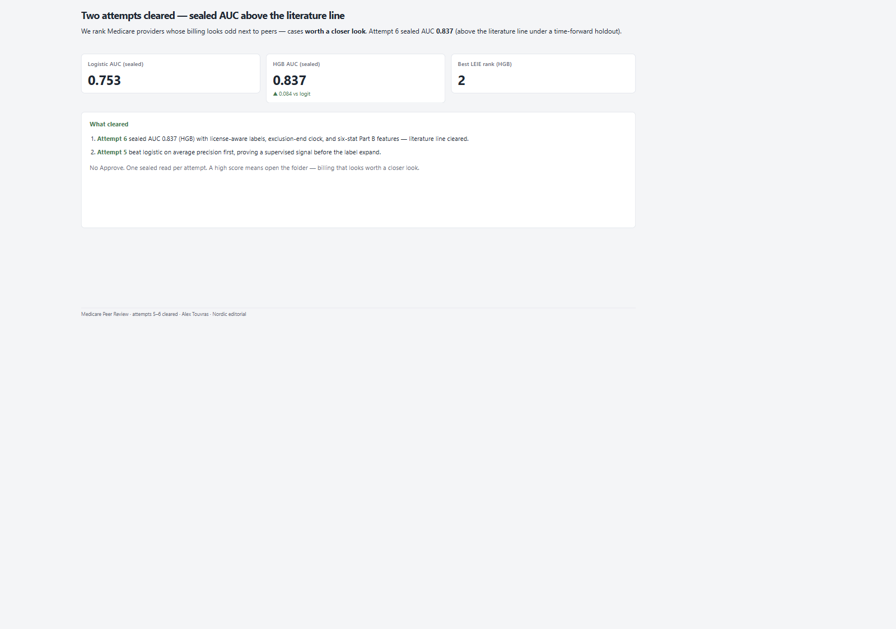

# 07 — Medicare Peer Review

Provider-year anomaly ceiling: sealed HGB AUC clears the literature line under a time-forward seal.

Frozen / journal pages only (OpenBI Studio Interactive labs are not in this repo).

## Preview

## Pages

| Id | Label | Role |
|----|-------|------|
| `introduction` | **Introduction** | Contextual score theory |
| `methodology` | **Methodology** | Peer cell → queue pipeline |
| `cover` | **Cover** | Sealed AUC verdict |
| `modelling` | **Modelling** | Freeze + AUC by learner |
| `attempts` | **Attempts** | Ladder of attempts |
| `population` | **Population** | Rows / NPIs / LEIE rate |
| `label` | **Label** | Keep-list + match limits |
| `method` | **Method** | Active-claim freeze knobs |
| `close` | **Close** | Findings + rollback |

## What's in the folder

| Piece | Path |
|-------|------|
| Screenshots | `screenshots/` |
| This page list | `README.md` |

Source Studio pack stays private in the OpenBI workspace. Re-export with `python scripts/export_orbit_openbi.py` from that workspace.
