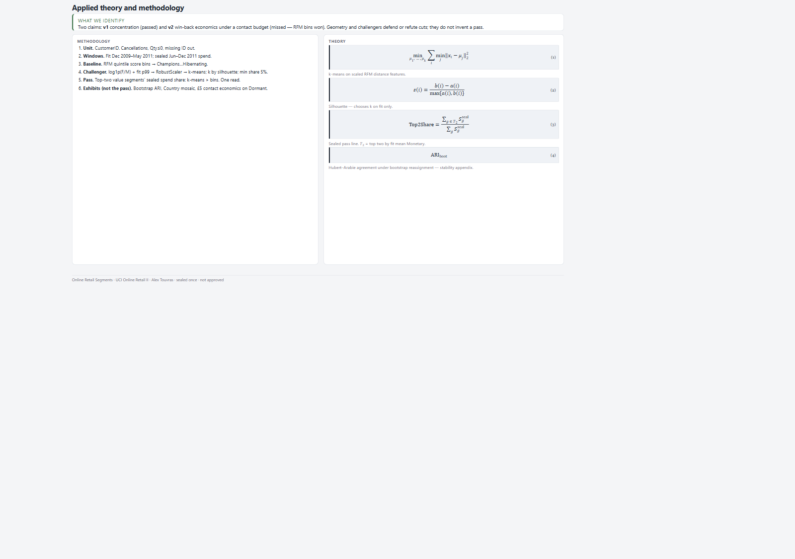
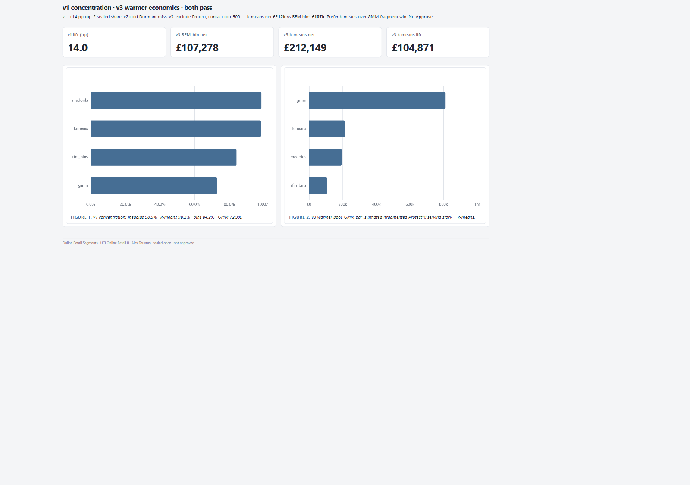
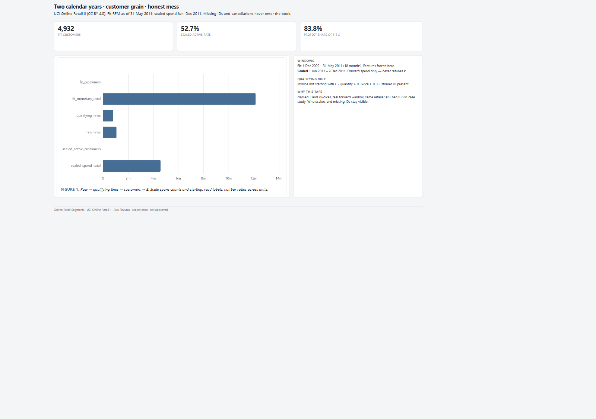

# 08 — Online Retail Segments

k-means on fit RFM beats RFM bins on sealed top-2 spend; warmer-pool economics claim also passed.

Frozen / journal pages only (OpenBI Studio Interactive labs are not in this repo).

## Preview

## Pages

| Id | Label | Role |
|----|-------|------|
| `introduction` | **Introduction** | k-means + RFM gates |
| `cover` | **Cover** | Pass line + sealed £ |
| `population` | **Population** | Customers + windows |
| `method` | **Method** | Silhouette k + ARI |
| `challengers` | **Challengers** | Medoids / GMM board |
| `profiles` | **Profiles** | Segment profiles |
| `map` | **Map** | R × M scatter |
| `geography` | **Geography** | Segment × country |
| `forward` | **Forward** | Sealed £ + lift |
| `economics` | **Economics** | Win-back net spend |
| `queue` | **Queue** | Win-back contact list |
| `close` | **Close** | Findings + limits |

## What's in the folder

| Piece | Path |
|-------|------|
| Screenshots | `screenshots/` |
| This page list | `README.md` |

Source Studio pack stays private in the OpenBI workspace. Re-export with `python scripts/export_orbit_openbi.py` from that workspace.
