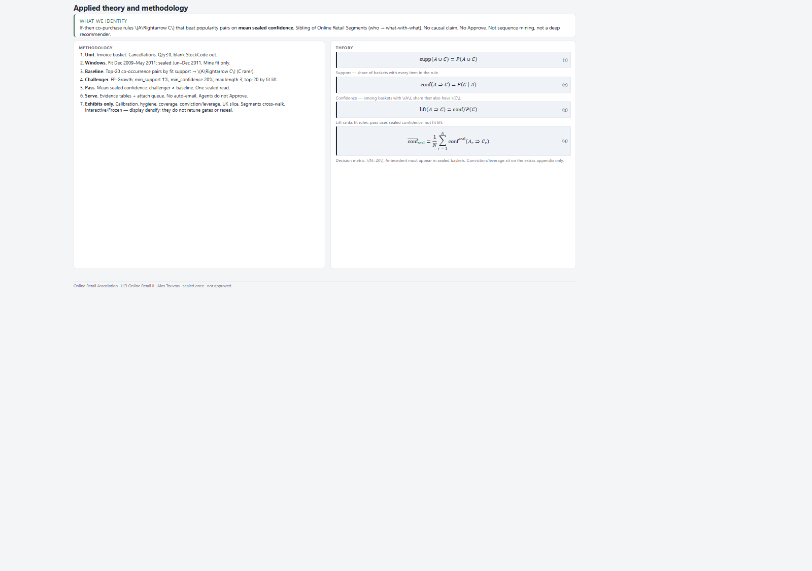
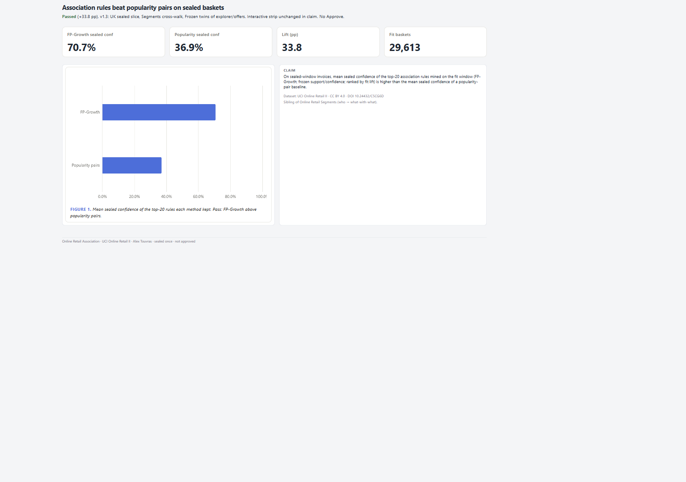
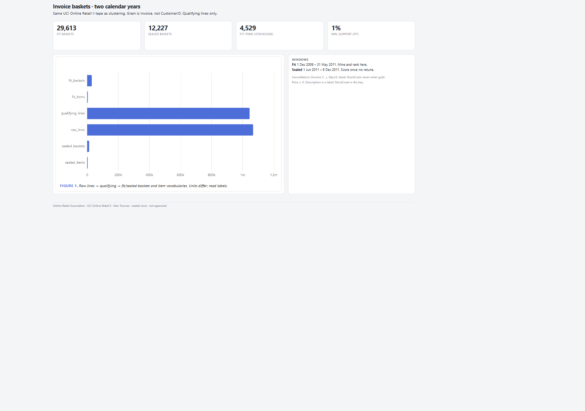

# 09 — Online Retail Association

FP-Growth top rules beat popularity pairs on mean sealed confidence — Frozen explorer/offers twins only.

Frozen / journal pages only (OpenBI Studio Interactive labs are not in this repo).

## Preview

## Pages

| Id | Label | Role |
|----|-------|------|
| `introduction` | **Introduction** | Support / conf / lift |
| `cover` | **Cover** | Sealed confidence verdict |
| `population` | **Population** | Baskets + windows |
| `method` | **Method** | FP-Growth vs popularity |
| `explorer-frozen` | **Explorer frozen** | Rules twin for slides |
| `sealed` | **Sealed** | Challenger vs baseline |
| `calibration` | **Calibration** | Fit → sealed conf |
| `uk-slice` | **UK slice** | UK vs non-UK fire |
| `segments` | **Segments** | Cross-walk to k-means |
| `extras` | **Extras** | Conviction / leverage |
| `offers-frozen` | **Offers frozen** | Illustrative offer twin |
| `close` | **Close** | Findings + limits |

## What's in the folder

| Piece | Path |
|-------|------|
| Screenshots | `screenshots/` |
| This page list | `README.md` |

Source Studio pack stays private in the OpenBI workspace. Re-export with `python scripts/export_orbit_openbi.py` from that workspace.
