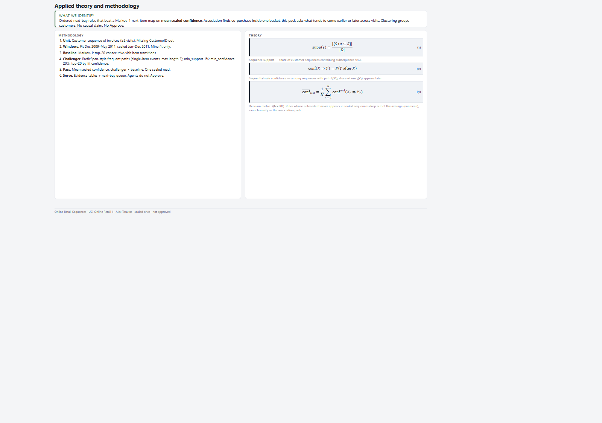
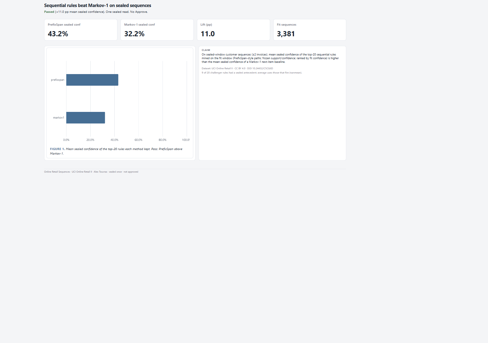
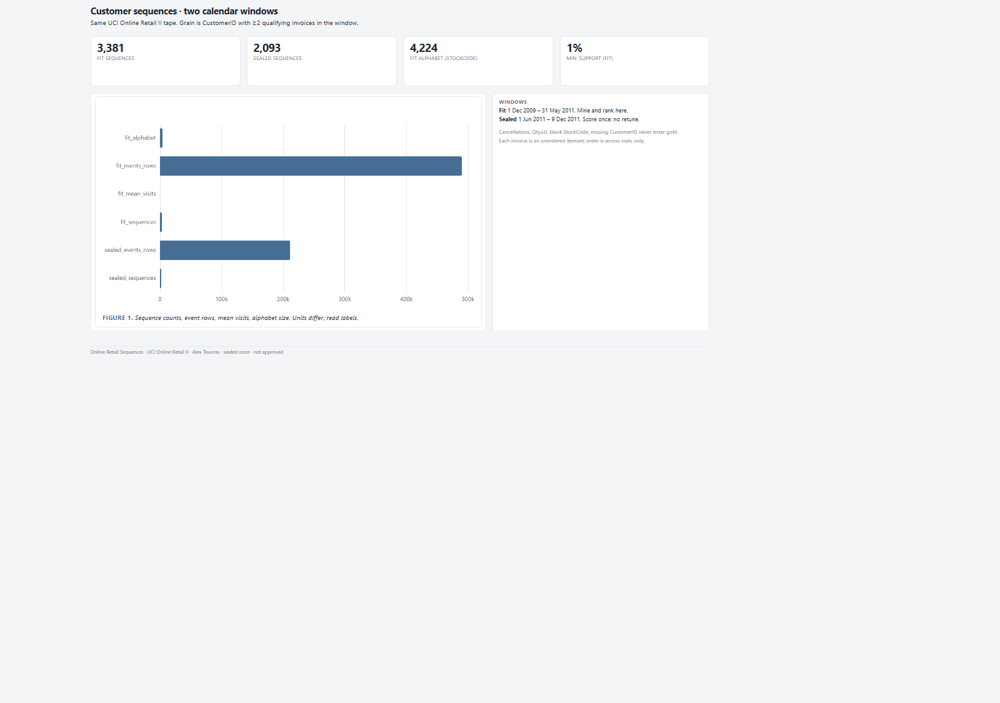

# 10 — Online Retail Sequences

PrefixSpan sequential rules beat Markov-1 on mean sealed confidence — next-buy paths without Interactive labs.

Frozen / journal pages only (OpenBI Studio Interactive labs are not in this repo).

## Preview

## Pages

| Id | Label | Role |
|----|-------|------|
| `introduction` | **Introduction** | Sequence support gates |
| `cover` | **Cover** | Sealed confidence verdict |
| `population` | **Population** | Sequences + alphabet |
| `method` | **Method** | PrefixSpan vs Markov-1 |
| `paths` | **Paths** | Top sequential rules |
| `sealed` | **Sealed** | Challenger vs baseline |
| `offers` | **Offers** | Next-buy queue |
| `close` | **Close** | Findings + limits |

## What's in the folder

| Piece | Path |
|-------|------|
| Screenshots | `screenshots/` |
| This page list | `README.md` |

Source Studio pack stays private in the OpenBI workspace. Re-export with `python scripts/export_orbit_openbi.py` from that workspace.
