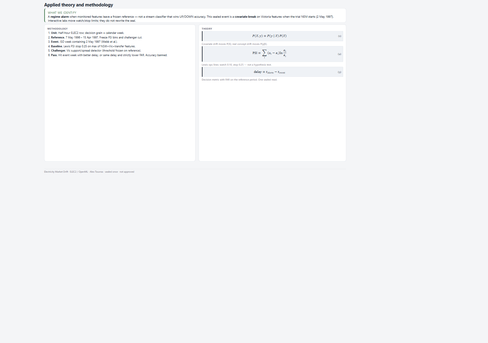
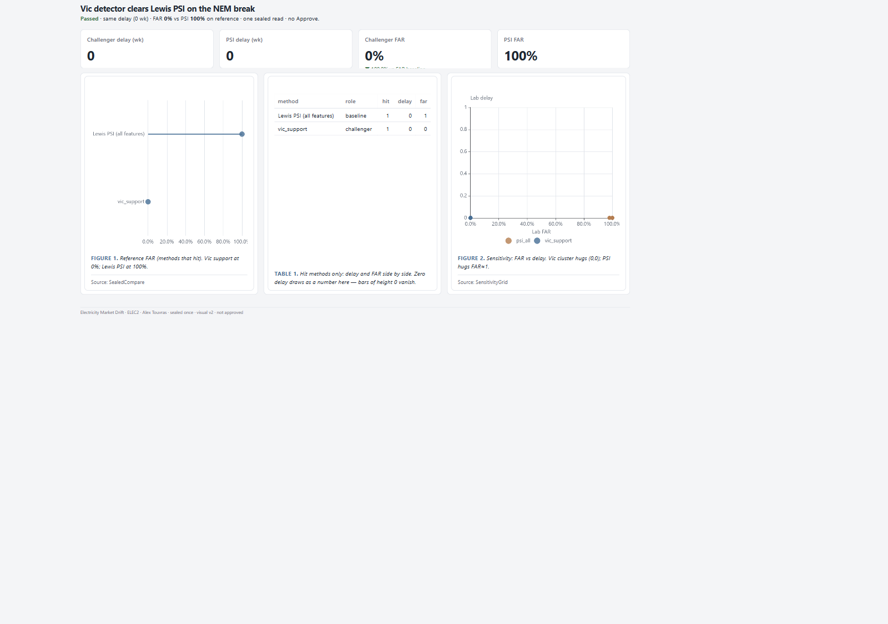
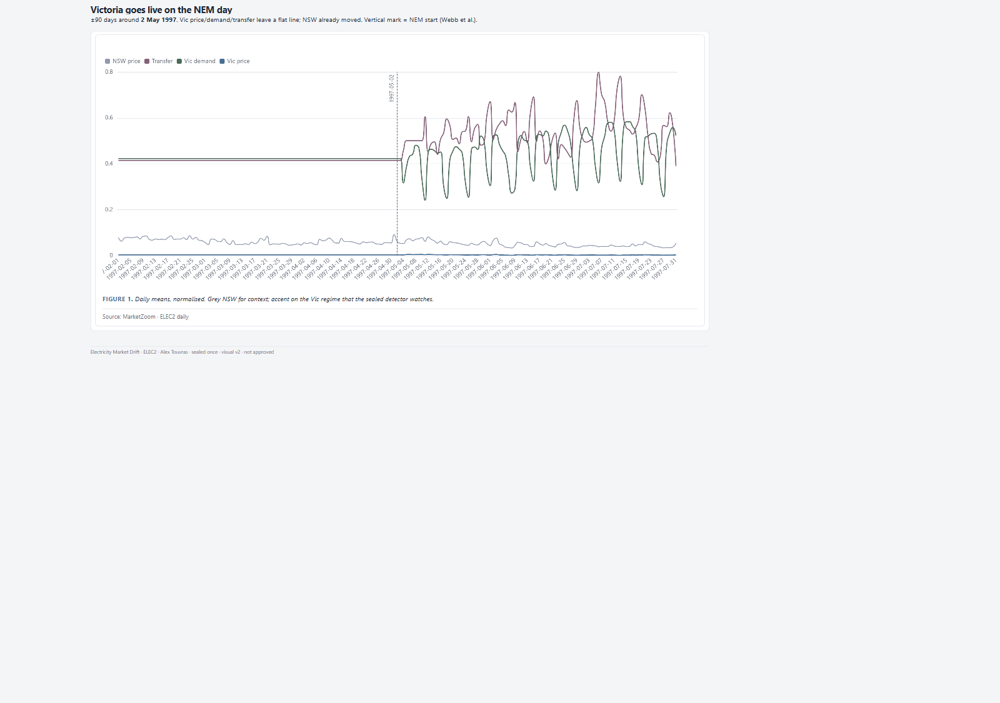

# 12 — Electricity Market Drift

Vic feature challenger hits the NEM-trial week with delay 0 and FAR 0% vs Lewis PSI FAR 100%.

Frozen / journal pages only (OpenBI Studio Interactive labs are not in this repo).

## Preview

## Pages

| Id | Label | Role |
|----|-------|------|
| `introduction` | **Introduction** | Real vs virtual drift |
| `cover` | **Cover** | Delay / FAR / hit verdict |
| `market` | **Market** | Vic series + NEM mark |
| `method` | **Method** | PSI vs challenger |
| `timeline` | **Timeline** | Alarms vs event band |
| `sealed` | **Sealed** | Delay / FAR compare |
| `monitor-lab-frozen` | **Frozen lab** | Sealed lever defaults |
| `honesty` | **Honesty** | No-Change honesty |
| `apply` | **Apply** | Cross-domain recipe |
| `close` | **Close** | Findings + limits |

## What's in the folder

| Piece | Path |
|-------|------|
| Screenshots | `screenshots/` |
| This page list | `README.md` |

Source Studio pack stays private in the OpenBI workspace. Re-export with `python scripts/export_orbit_openbi.py` from that workspace.
