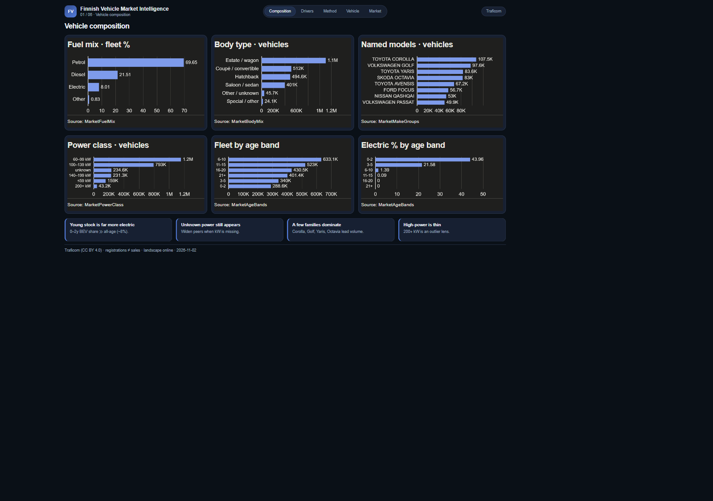
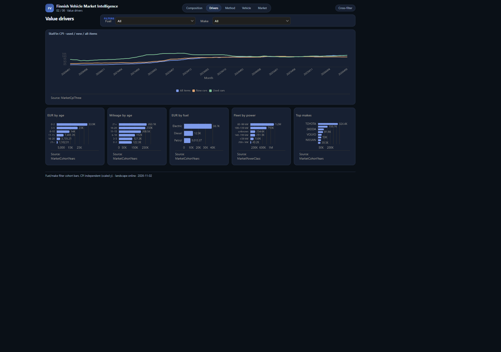
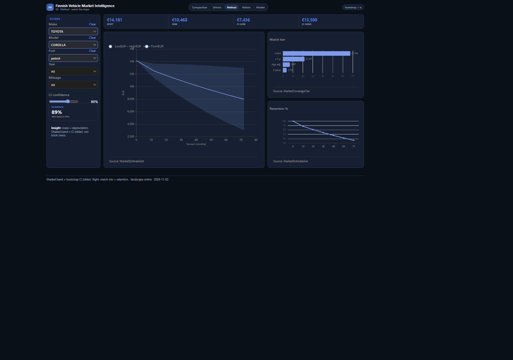

# 13 — Finnish Vehicle Market Intelligence

Public Traficom / CPI market pack — composition through valuation overview (no Frozen twin; default view only).

Frozen / journal pages only (OpenBI Studio Interactive labs are not in this repo).

## Preview

## Pages

| Id | Label | Role |
|----|-------|------|
| `market-01` | **Composition** | Vehicle composition |
| `market-02` | **Drivers** | Value drivers |
| `market-03` | **Method** | Market data → valuation |
| `market-04` | **Valuation** | Vehicle valuation strip |
| `market-05` | **Overview** | Market overview |
| `market-06` | **Decisions** | Supporting better decisions |

## What's in the folder

| Piece | Path |
|-------|------|
| Screenshots | `screenshots/` |
| This page list | `README.md` |

Source Studio pack stays private in the OpenBI workspace. Re-export with `python scripts/export_orbit_openbi.py` from that workspace.
